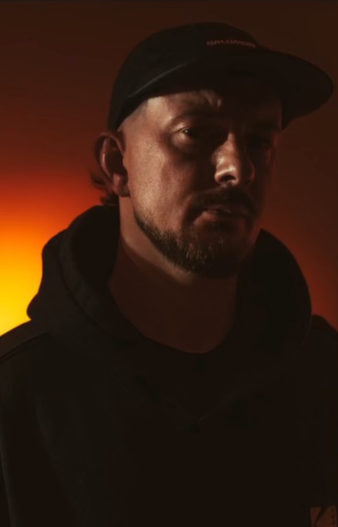

# A.RES

Lille, France · Minimal / Micro house · 120–130 BPM

---

## Bio courte

Originaire de Belgique et installé à Lille, A.RES joue depuis 2019 : house, minimal,
micro house, entre 120 et 130 BPM. Fondateur du collectif Univers Parallele, il joue en
formats de 1h30 à six heures.

## Bio longue

Originaire de Belgique, A.RES découvre très tôt la culture électronique. À 15 ans, il commence à fréquenter les clubs et soirées qui vont façonner son identité musicale, du Decadance au Fuse, en passant par le Club Vaag et d’autres lieux emblématiques de la scène belge.

Sa passion pour la house et le monde de la nuit grandit rapidement. Influencé par des artistes comme Ricardo Villalobos, Fedo, Maya Jane Coles ou encore Jane Fitz, il développe au fil des années un univers personnel, entre house, minimal et micro house.

À travers ses sets portés par le groove, sa sélection est une véritable culture du club.

Une vision libre de la nuit, entre minimalisme, profondeur et énergie.

---

## Formats de set

| Format | Durée | Setup | Note |
|---|---|---|---|
| DJ set | 1h30 – 3h | Matériel du lieu | Format standard |
| Extended | 4h – 6h | Matériel du lieu | Sur demande |

**A.RES joue sur le matériel du lieu.** Deux lecteurs et un mixer suffisent, lecture depuis
clés USB. Détail dans la fiche technique.

## Repères

| | |
|---|---|
| Base | Lille, France |
| Origine | Belgique |
| Actif depuis | 2019 |
| Style | House, minimal, micro house |
| Tempo | 120–130 BPM |
| Collectif | Univers Parallele, fondateur |
| Territoire | Europe |

---

## Mixes

- **A.RES — micro halloween** — 2025 · 54 min · [SoundCloud](https://soundcloud.com/dorian-moreau-453577433/a-res-micro-halloween)
- **A.RES B2B UNKNOW (JSW)** — 2025 · 59 min · [SoundCloud](https://soundcloud.com/dorian-moreau-453577433/ares-b2b-unknow-jsw)

<!-- Sorties, dates marquantes et presse : sections retirées tant qu'il n'y a rien de réel
     à y mettre. Un presskit d'une page dense vaut mieux qu'un presskit à moitié rempli.
     On les rouvre après les premières dates. -->

---

## Liens

- **Instagram** — [@a.res_music](https://www.instagram.com/a.res_music/)
- **SoundCloud** — [dorian-moreau-453577433](https://soundcloud.com/dorian-moreau-453577433)

## Contact

**Booking** — Dorian Moreau, dorian.moreau056@gmail.com
**Territoire** — Europe

---

## Ressources

- Photos HD, libres de droits pour la promotion, crédit obligatoire
- Fiche technique — `TECHNICAL-RIDER.md`
- Ce presskit en PDF — `presskit.pdf`

---

*Presskit mis à jour le 19 octobre 2026. Merci de ne pas recadrer les visuels ni retirer les crédits.*
